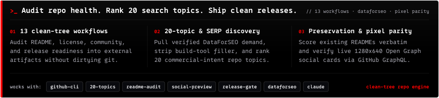
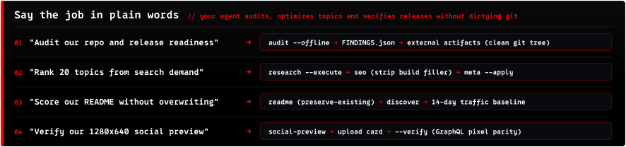
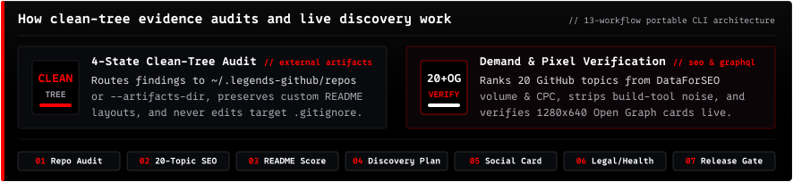
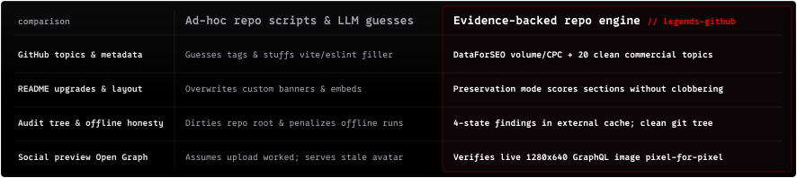

# 

[](https://github.com/avalonreset/legends-github/releases/latest)
[](https://github.com/avalonreset/legends-github/actions/workflows/ci.yml)
[](github/requirements.txt)
[](legends_github.py)
[](LICENSE)

**GitHub repository audit, release readiness, DataForSEO 20-topic SEO discovery, non-destructive README scoring, and 1280x640 Open Graph social preview pixel-parity CLI (`legends_github.py`) for coding agents.**


```text
Install or update legends-github via cto-legends (https://github.com/avalonreset/cto-legends): run `cto-legends install legends-github --apply`, then `cto-legends handoff legends-github` and follow the returned JSON recipe to verify `legends_github.py`.
```



## Why `legends-github` exists

Ask an unguided coding agent or generic repo linter to "clean up our GitHub repository and optimize it for discovery" and three failure modes show up immediately:

1. **Guessed topics and build-tool noise:** Most GitHub SEO scripts scrape `package.json` or `pyproject.toml` and stuff your 20 GitHub topic slots with build dependencies like `vite`, `webpack`, `eslint`, or `typescript` instead of the commercial and technical queries developers actually search on Google and GitHub.
2. **Clobbered READMEs and dirty working trees:** Template-driven README generators overwrite custom hero banners, SVG architecture cards, and video embeds with generic boilerplate, while audit scripts dump untracked `.github-audit` folders and `.gitignore` edits straight into your repository root.
3. **False offline audit failures and unverified social cards:** Naive checklists treat offline mode or unauthenticated `gh` sessions as missing repository files, and assume a browser file-picker click updated your Open Graph social card without verifying whether GitHub's CDN is still serving a stale cache or default avatar.

`legends-github` replaces guesswork with 13 evidence-backed workflows (`audit`, `research`, `seo`, `meta`, `readme`, `discover`, `social-preview`, `release`, `community`, `legal`, `empire`, `verify`, and `cache-status`). Every diagnostic report and cache file is isolated outside your repository working tree (`~/.legends-github/repos/<hash>` or `--artifacts-dir`), existing README layouts are evaluated in non-destructive preservation mode, and live Open Graph cards are verified pixel-for-pixel via GitHub GraphQL.

## Ask in plain english

Once [`cto-legends`](https://github.com/avalonreset/cto-legends) is installed, you ask your coding agent in plain english. It routes all reports and caches outside your git checkout, previews metadata and release plans before mutating remote state, and verifies live social cards:



## Architecture: clean-tree evidence audits and live discovery



### 1. Four-state clean-tree audits and non-destructive README preservation (`audit`, `readme`)

- **Four-state evidence accounting (`FINDINGS.json`):** Every audit check records its source, collection timestamp, confidence, and applicability (`observed`, `missing`, `unavailable`, or `not_applicable`). Running with `--offline` or without `gh` authentication marks remote checks `unavailable` rather than falsely penalizing your project for missing files.
- **External artifact isolation:** By default, `repo_cache_dir()` routes all audit scorecards, keyword caches, and verification receipts to `~/.legends-github/repos/<hash>` (or your explicit `--artifacts-dir`), never creating untracked files or editing `.gitignore` inside your target repository.
- **Preservation-mode README scoring (`preserve-existing`):** When a repository already has a `README.md`, `readme_repo.py` preserves existing prose, HTML embeds, badges, and section order verbatim while recognizing both agent-first onboarding (`Agent setup`, `Ask in plain english`, `Architecture`, `Quick start`, `Reference`) and traditional `Installation` and `Usage` sections.

### 2. Measured 20-topic GitHub SEO and organic discovery (`research`, `seo`, `meta`, `discover`)

Instead of guessing keywords from filenames, `legends-github` pairs local repository evidence with optional bounded search research powered by [`legends-dataforseo`](https://github.com/avalonreset/legends-dataforseo):

- **Bounded demand & SERP collection (`research`):** Estimate or execute Google keyword overview and organic SERP batches (up to 100 keywords and 10 SERPs per batch) under an explicit `--confirm-cost-usd` ceiling, writing an exact `receipt.json` cost ledger.
- **20-slot commercial topic synthesis (`seo`, `meta`):** Ranks secondary keywords by verified monthly search volume and commercial CPC (`cpc`, `competition_level`), checks whether `github.com` repositories already rank in Google's top 10 (`github_in_serp`, `github_serp_position`), strips low-value build filler (`vite`, `webpack`, `eslint`, `prospecting`), and prevents vendored router pins (`skills/cto-legends/SKILL.md`) from misclassifying CLIs or applications as skills.
- **Organic discovery & 14-day traffic baseline (`discover`):** Builds an evidence-backed discovery plan covering reproducible first results, workload cost transparency, dated competitor comparison matrices, and 14-day `gh api` views, clones, referrers, and release download baselines.

### 3. The 13 repository workflows (`legends_github.py`)

| Surface | Workflows | What It Does |
| :--- | :--- | :--- |
| **Health & Readiness** | `verify`, `audit`, `cache-status` | Validate Python 3.11+, `git`, `gh`, and cache readiness (`verify`), collect 4-state repository findings (`audit`), and inspect isolated external cache artifacts (`cache-status`). |
| **Search Demand & Metadata** | `research`, `seo`, `meta`, `discover` | Collect bounded DataForSEO keyword and SERP demand (`research`), synthesize 20 clean GitHub topics and About descriptions (`seo`), apply via `gh repo edit` (`meta --apply`), and plan organic discovery (`discover`). |
| **README & Social Preview** | `readme`, `social-preview` | Score or scaffold READMEs in non-destructive preservation mode (`readme`) and validate 1280x640 Open Graph cards with post-upload GitHub GraphQL pixel-parity verification (`social-preview --verify`). |
| **Governance, Releases & Portfolio** | `legal`, `community`, `release`, `empire` | Inventory `LICENSE`, `SECURITY.md`, `CITATION.cff`, and third-party notices without inventing legal claims (`legal`), scaffold contributor health files (`community`), gate semver tags and changelogs (`release`), and align multi-repo portfolios (`empire`). |

## Ad-hoc repo scripts vs `legends-github`



## Quick start

```sh
# 1. Inspect the machine-readable 13-workflow capability contract and check local readiness
python legends_github.py capabilities
python legends_github.py --offline --artifacts-dir ./review-output verify --path /path/to/your/repo

# 2. Run a clean-tree repository audit and non-destructive README evaluation
python legends_github.py --offline --artifacts-dir ./review-output audit --path /path/to/your/repo
python legends_github.py --offline --artifacts-dir ./review-output readme --path /path/to/your/repo

# 3. Collect bounded DataForSEO keyword & SERP evidence and apply 20 GitHub topics
python legends_github.py research --path /path/to/your/repo --keyword "github seo" --keyword "open source seo tools" --serp "github seo" --execute --confirm-cost-usd 0.05
python legends_github.py seo --path /path/to/your/repo --keyword-data ./review-output/research-latest/demand.json --primary-keyword "github seo" --serp-data ./review-output/research-latest/serp-1.json
python legends_github.py meta --path /path/to/your/repo --apply

# 4. Prepare and verify a live 1280x640 Open Graph social preview card via GitHub GraphQL
python legends_github.py social-preview --repo OWNER/REPO --image /absolute/path/social-preview.png --output ./review-output/prepared.json
python legends_github.py social-preview --repo OWNER/REPO --image /absolute/path/social-preview.png --verify --output ./review-output/verified.json
```

## Reference

<details>
<summary><strong>Helper scripts, banner rendering, and organic discovery guides</strong></summary>

| Script | Flags | Purpose |
| :--- | :--- | :--- |
| `github/scripts/validate_setup.py` | `--mode {portable,cli,api,both} --path PATH [--json]` | Validate Python 3.11+, Git, GitHub CLI (`gh`), and isolated external cache readiness. |
| `github/scripts/setup_dataforseo.py` | `--check`, `--json`, `--install` | Check or install the pinned `legends-dataforseo` research provider from `requirements-dataforseo.txt`. |
| `github/scripts/render_banner.py` | `--title SLUG --subtitle-line LINE --font PATH --output-dir DIR` | Render 4096x1024 PNG/WebP banners and 1024x256 preview into a fresh directory. |
| `github/scripts/render_social_preview.py` | `--title SLUG --subtitle TEXT --font PATH --output PATH.png [--force]` | Render a 1280x640 Open Graph social card with exclusive file creation (`--force` to overwrite). |

See the [module recipe](docs/GITHUB-RECIPE.md), [agent recipe](docs/AGENT-RECIPE.md), [DataForSEO research guide](docs/SEO-RESEARCH.md), [discovery guide](docs/DISCOVERY.md), [social preview SOP](github/references/social-preview-sop.md), [README style guide](github/references/legends-readme-style.md), and [banner generation guide](github/references/banner-generation.md).

</details>

<details>
<summary><strong>Agent setup (via <code>cto-legends</code>) and standalone installation</strong></summary>

### Agent setup (via `cto-legends`)

Part of [cto-legends](https://github.com/avalonreset/cto-legends). The central router skill is vendored at [skills/cto-legends/SKILL.md](skills/cto-legends/SKILL.md); this module is not a separate registered skill and requires no MCP server setup or paid image API keys.

Run `cto-legends handoff legends-github` and read the returned installed recipe and task-readiness checks. If the module is missing, preview setup with `cto-legends install legends-github`, perform the authorized setup, then repeat the handoff. Use `cto-legends check-updates` to compare your installed version with the catalog and published release. See [docs/AGENT-RECIPE.md](docs/AGENT-RECIPE.md) and [AGENTS.md](AGENTS.md) for the standalone recipe.

```sh
python -m pip install -r github/requirements.txt
python -m pip install -r requirements-dataforseo.txt
python legends_github.py capabilities
```

</details>

<details>
<summary><strong>Repository layout, verification, and disclaimer</strong></summary>

- [`legends_github.py`](legends_github.py): Portable CLI entrypoint and 13-workflow capability registry.
- [`github/scripts/`](github/scripts): Deterministic Python workflows (`audit_repo.py`, `audit_evidence.py`, `seo_repo.py`, `seo_research.py`, `research_dataforseo.py`, `meta_repo.py`, `readme_repo.py`, `discovery_repo.py`, `release_repo.py`, `community_repo.py`, `legal_repo.py`, `empire_repo.py`, `social_preview.py`).
- [`github/references/`](github/references): Rubrics, evidence contracts, banner and social-preview SOPs, and SEO guides.
- [`skills/cto-legends/SKILL.md`](skills/cto-legends/SKILL.md): Pinned copy of the central [`cto-legends`](https://github.com/avalonreset/cto-legends) router skill.

```sh
python -m pytest tests -v
python scripts/check_release.py
```

**Disclaimer:** This tool provides automated recommendations for GitHub repository optimization, including license inventory and compliance guidance. **It is not legal, financial, or professional advice.** All recommendations should be reviewed with your own due diligence before applying. For complex licensing or compliance situations, consult a qualified attorney.

</details>

## Contributing, security, and license

Scaffolded with [skill-forge](https://github.com/AgriciDaniel/skill-forge), with SEO methodology adapted from [claude-seo](https://github.com/AgriciDaniel/claude-seo). See [CONTRIBUTING.md](CONTRIBUTING.md), [SUPPORT.md](SUPPORT.md), and [SECURITY.md](SECURITY.md).

MIT License. See [LICENSE](LICENSE), [NOTICE](NOTICE), and [THIRD_PARTY_NOTICES.md](THIRD_PARTY_NOTICES.md). Copyright (c) 2026 Avalon Reset.

## Start here

Paste the [agent handoff block](#top) at the top of this page into your coding agent, let it wire the `cto-legends` router skill, and speak your task in plain English.

Running a company and not a terminal? Founders and operators who want this way of working applied directly to their own business stack have one route: message Avalon Reset at [cto-legends.com/dm](https://cto-legends.com/dm) or start with a 48-hour diagnostic at [cto-legends.com/home#home-offer](https://cto-legends.com/home#home-offer). The desk is async, so the conversation starts the moment you write and nobody forces you onto a sales call.

<p align="center"><a href="https://cto-legends.com/dm"></a></p>

<p align="center"><a href="https://github.com/stars/avalonreset/lists/cto-legends"></a></p>

**Specification & benchmarks on cto-legends.com:**
- **Module specification & architecture matrix:** [cto-legends.com/modules/legends-github](https://cto-legends.com/modules/legends-github)
- **Related engineering dispatches:** [Routing Cursor vs Claude Code by Blast Radius and Cost](https://cto-legends.com/blog?post=cursor-vs-claude-code) · [How to Vet an AI Implementation Consultant in 15 Minutes](https://cto-legends.com/blog?post=ai-implementation-consultant) · [How to Choose MCP vs CLI Tools Without Context Bloat](https://cto-legends.com/blog?post=mcp-vs-cli)
- **Ecosystem hub:** [cto-legends.com/home](https://cto-legends.com/home)
